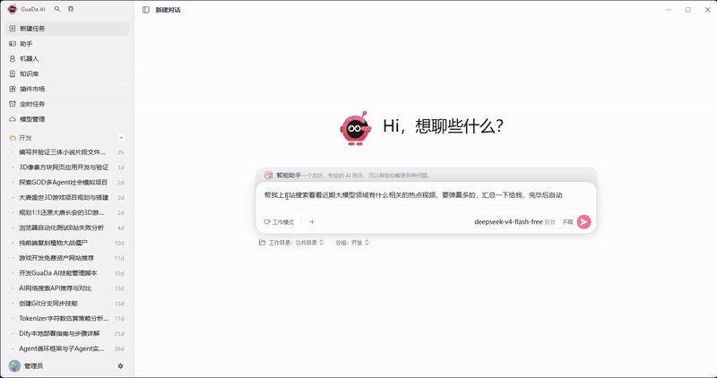
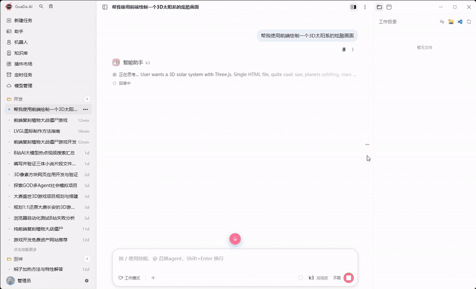
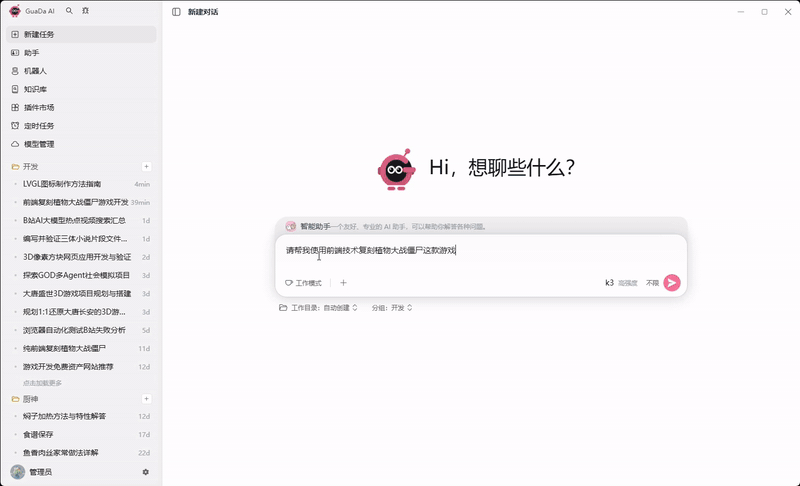
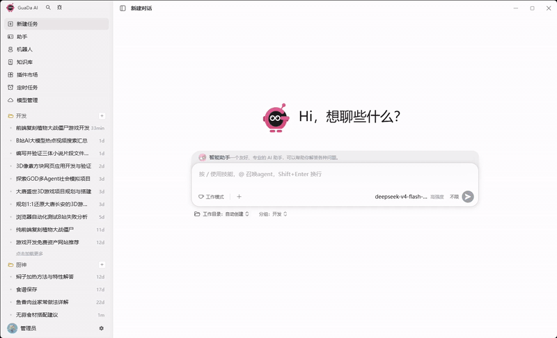
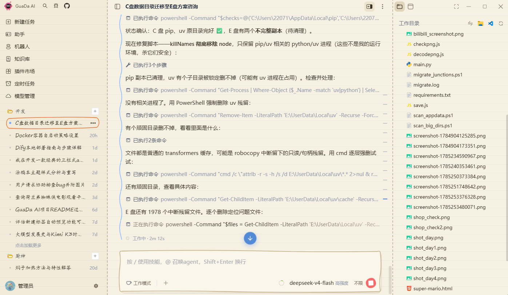
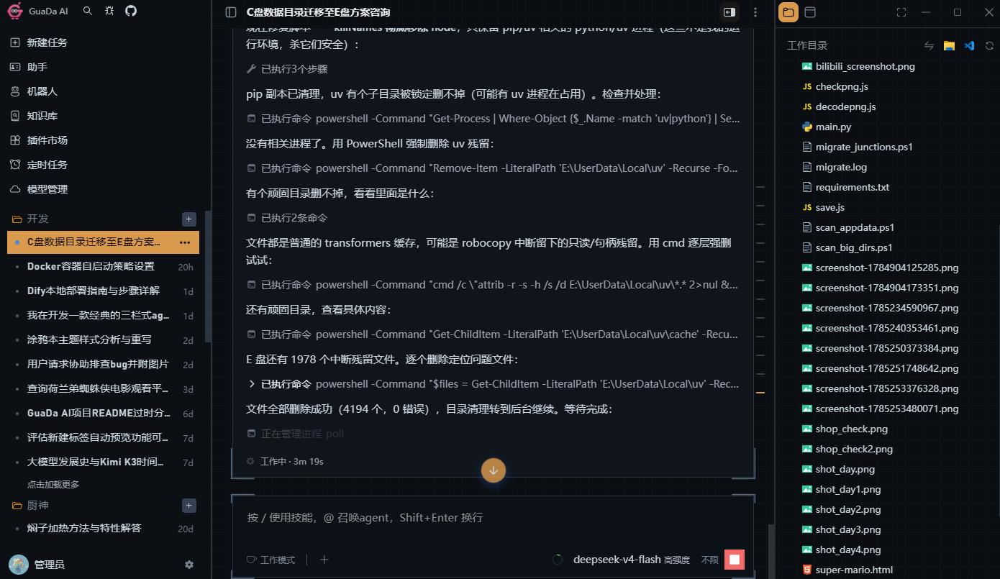
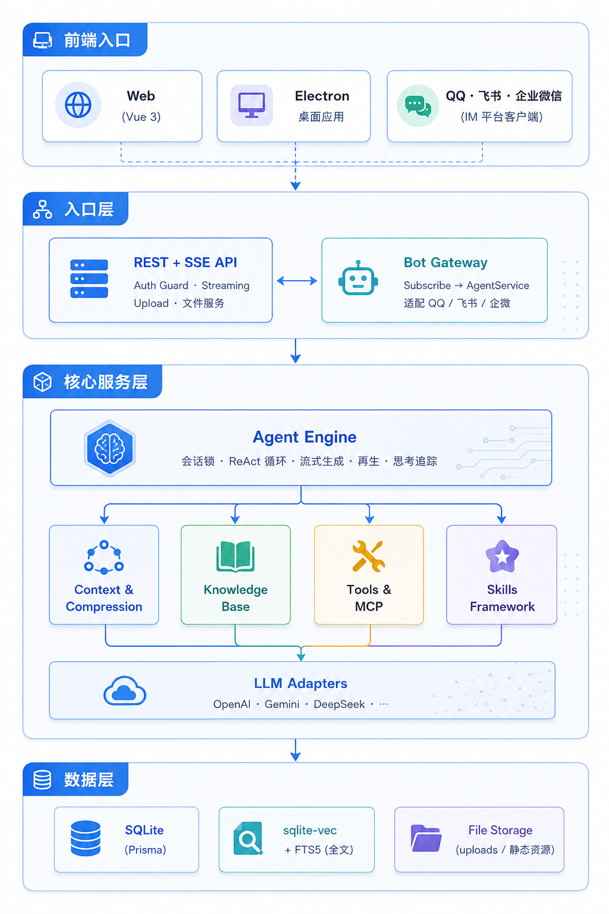
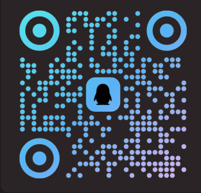

# ⚡ GuaDa AI — 把你的电脑变成 AI 工作站

> **看得见、摸得着、能动手**的桌面 AI 工作站。基于 ReAct Agent + 子 Agent 分层架构，一个引擎统一服务 **Web / 桌面 / IM** 三大入口。

<p align="center">
  <a href="https://gitee.com/zhendongdong/guada_ai/stargazers"></a>
  <a href="https://gitee.com/zhendongdong/guada_ai/members"></a>
  
  
  
  
  
  
</p>

<p align="center">
  <a href="#-项目介绍"><b>💡 项目介绍</b></a> ·
  <a href="#-与同类工具对比"><b>📊 对比</b></a> ·
  <a href="#-核心能力"><b>🧠 核心能力</b></a> ·
  <a href="#-远程工作区本地大脑远程手脚"><b>🖥️ 远程工作区</b></a> ·
  <a href="#-快速开始5分钟上手"><b>🚀 快速开始</b></a> ·
  <a href="#-部署文档索引"><b>📚 部署文档</b></a> ·
  <a href="#-常见问题"><b>❓ 常见问题</b></a> ·
  <a href="https://gitee.com/zhendongdong/guada_ai/issues"><b>💬 反馈</b></a> ·
  <a href="#-社区"><b>🤝 加入社区</b></a>
</p>

<p align="center">
  <a href="README.en.md">English</a> · 
  <a href="https://gitee.com/zhendongdong/guada_ai">Gitee</a> ·
  <a href="https://github.com/donggua-zen/guada">GitHub</a> ·
  <a href="https://atomgit.com/donggua_sherlock/GuaDaAI">GitCode</a>
</p>

---

## 📖 项目介绍

GuaDa 是一个**本地优先**的开源 AI 工作站——它不只是聊天框，而是一个能动手干活的 AI 工作台：读写文件、执行命令、操控内嵌浏览器，任务从规划到执行自动闭环。

一套 Agent 引擎，三种使用方式：**桌面端**开箱即用，**Web 端**可私有化部署，**QQ / 企业微信 / 飞书 / Discord / 微信** 群里也能直接召唤。配合 RAG 知识库、长期记忆和定时任务，它能记住你的资料、按你的习惯工作、在你睡觉时继续干活。数据默认存在你自己的机器上，安全可控。

需要动用**服务器、NAS、虚拟机、开发板**上的文件时，它还能在同一个会话里把多台机器挂载进来——AI 留在本机，只把手伸进去。详见 [🖥️ 远程工作区](#-远程工作区本地大脑远程手脚)。

无论你是写脚本追热点的**新媒体人**、想让 Agent 代写代码的**程序员**、需要它记住人物设定的**创作者**，还是想搭一个绑定知识库、接入 IM 的内部 AI 助手的**团队**——GuaDa 都能直接上手。如果这个项目对你有帮助，欢迎点亮 Star ⭐，你的支持是持续更新的动力。

---

## 🖼️ 产品截图

<p align="center">
  
  
</p>
<p align="center">
  
  
</p>
<p align="center">
  
  
</p>

---

## 📊 与同类工具对比

| 维度 | **GuaDa** | Claude Code | Codex | Trae Work |
|------|:---------:|:-----------:|:-----:|:---------:|
| **产品定位** | 🏠 通用 AI 工作站 | 💻 编程 Agent | 💻 编程 Agent | 📋 AI 任务执行平台 |
| **开源** | ✅ | ❌ | ✅ CLI | ❌ |
| **自托管 Web 部署** | ✅ | ❌ | ❌ | ❌ |
| **Desktop 桌面端** | ✅ | ✅ | ✅ | ✅ |
| **CLI** | ❌ | ✅ | ✅ | ⚠️ |
| **Bot / IM 接入** | ✅ QQ·企微·飞书·Discord·微信 | ❌ | ❌ | ❌ |
| **知识库 (RAG)** | ✅ 混合检索·40+ 格式 | ❌ | ❌ | ⚠️ 代码索引 |
| **浏览器自动化** | ✅ 内嵌·可视操控 | ✅ 内嵌·可视操控（2026.7） | ⚠️ 需 Chrome 扩展·内置仅预览 | ⚠️ 远端投屏·内嵌仅预览 |
| **沙盒** | ✅ 轻沙盒 | ✅ 文件+网络双隔离 | ✅ 云端容器+本地 | ✅ 云端容器+本地文件权限 |
| **远程 / 多机开发** | ✅ 直连自己的服务器·NAS·虚拟机·开发板，本地与多台远程同会话 | ⚠️ 无远端目录，需在远端运行整套 | ⚠️ 云端沙箱·代码上传 | ⚠️ 云端容器 |
| **长期记忆** | ✅ 可编辑可回退 | ⚠️ 文件式 | ⚠️ 文件式 | ❌ |
| **定时任务** | ✅  | ❌ | ❌ | ❌ |
| **多Agent** | ✅ 全能力独立配置（角色/模型/工具/知识库） | ⚠️ 仅子代理·限 Claude 模型·不可嵌套 | ⚠️ 仅子代理·不可嵌套 | ❌ |
| **多模型支持** | ✅ 17 家厂商·含国产模型 | ❌ 仅 Claude | ❌ 仅 OpenAI | ⚠️ |
| **数据本地可控** | ✅ | ❌ | ❌ | ❌ |
| **配置难易** | ⭐⭐⭐⭐ 开箱即用 | ⭐⭐⭐ 登录即用 | ⭐⭐⭐ API Key 即用 | ⭐⭐⭐⭐⭐ 登录即用 |
| **费用** | 免费（自备 Key） | $20+/月 | $20+/月 | 内测免费 |


## 🧠 核心能力

| 能力 | 亮点说明 | 文档 |
|------|---------|------|
| **🤖 智能体（Agent）** | ReAct 多轮自治循环 + 子 Agent 分层委派，支持会话锁、流式传输、中断处理与三种再生模式 | [→ 详情](docs/agent-engine.md) |
| **👥 子 Agent 系统** | 全能力独立配置（角色/模型/工具/知识库），复杂任务自动拆解 → 委派执行 → 结果归集 | [→ 详情](docs/sub-agent.md) |
| **🔌 插件系统** | 核心功能全部插件化（浏览器/文件/搜索/记忆/定时任务/角色等），PluginBase 生命周期 + 热插拔即时生效，工具包级权限过滤 | — |
| **📚 知识库 (RAG)** | 语义 + 关键词双混合检索，Agent 自助多轮搜索与写入，支持 **40+ 文件格式**（含 OCR） | [→ 详情](docs/knowledge-base.md) |
| **🧠 长期记忆** | 两级压缩（裁剪→语义），可编辑、可回退、有历史，非破坏性压缩 | [→ 详情](docs/memory.md) |
| **🛠️ 技能管理** | 文件即技能，chokidar 热更新即时生效，渐进式加载省 Token | [→ 详情](docs/skills.md) |
| **⏰ 定时任务** | Agent 按 Cron 自动执行，独立会话隔离，完整执行记录 | [→ 详情](docs/scheduler.md) |
| **🤖 Bot 网关** | 统一接入 **QQ / 企业微信 / 飞书 / Discord / 个人微信**，自动重连、消息合并、动态启停 | [→ 详情](docs/bot-gateway.md) |
| **🌐 浏览器自动化** | Electron 内嵌 Chromium，Agent 实时可视操控。 | [→ 详情](docs/browser-automation.md) |
| **🧩 多模型管理** | 5 种协议适配器 × **17 家厂商**（OpenAI / Claude / Gemini / Azure / DeepSeek / 通义 / 文心 / 智谱 / Kimi / 火山 / Minimax 等），角色级/会话级/全局级配置 | [→ 详情](docs/models.md) |
| **🛡️ 沙箱模式** | Shell 命令经独立沙箱进程隔离执行，Agent 动手更安全 | [→ 详情](docs/windows-sandbox-isolation-design.md) |
| **🖥️ 远程工作区** | 把**服务器·NAS·虚拟机·开发板（SSH）**、**运行中的 Docker 容器**与**本机 WSL 发行版**挂成「附加工作目录」，本地与多台远程同一会话；远端只需一个约 10MB 的静态二进制，容器 / 发行版零侵入 | [→ 详情](#-远程工作区本地大脑远程手脚) |
| **🔗 MCP 集成** | 原生支持 MCP 协议，接入外部工具生态 | — |
| **📦 多部署方式** | Electron 桌面 + Web 应用 + Docker 容器化，开箱即用 | [→ 部署指南](#-快速开始5分钟上手) |
| **🗄️ 企业级数据** | 默认 SQLite，Prisma 7 ORM 可无缝切换 MySQL / PostgreSQL | — |
| **🎨 自定义壁纸** | 自定义背景、透明度、毛玻璃效果，打造你的专属工作站 | — |

---

## 🖥️ 远程工作区：本地大脑，远程手脚

**不把开发环境搬到服务器上，只把 AI 的手伸进去。** 主工作目录始终在本地，远程目录作为「附加工作目录」挂进同一个会话——本地和多台远程机器**同时可用**，AI 用 `workspace="连接名"` 指定在哪台机器上动手。

三种可挂载的目标：**SSH 远程主机**（服务器 / NAS / 虚拟机 / 开发板）、**运行中的 Docker 容器**（devcontainer、`docker compose` 起的服务等）与**本机 WSL 发行版**（Windows Subsystem for Linux，发行版里不用配 sshd）。

嵌入式 Linux 开发是这套设计的典型主场：Windows 上位机管编辑、串口与烧写，每个项目一台 Linux 虚拟机管交叉编译，板端管运行——三层缺一不可，而 AI 只需要一个入口。

| 嵌入式开发的三层 | 它承担什么 | 在 GuaDa 里 |
|------|------|------|
| **Windows 上位机** | IDE、串口工具、烧写与调试工具 | **主工作目录**：AI 就在本机，烧写脚本与调试工具随手可调 |
| **每个项目的 Linux 虚拟机** | 交叉编译、SDK/BSP、内核源码 | **附加远程目录**：直接改源码、跑 `make`，虚拟机里不用装任何东西 |
| **板端 / 目标设备** | 设备树、rootfs、内核模块、串口日志 | **附加远程目录**：读 `dmesg`、换 `.ko`，可设为只读 |

- **远端零依赖**：执行代理是单个静态二进制（约 10MB，无 cgo，不依赖 Node 与 glibc），现有构建覆盖 linux / macOS × amd64 / arm64，老 glibc 的精简系统同样能跑。
- **容器零侵入**：接入已有容器（如 VS Code devcontainer）时，代理经 `docker cp` 注入容器内 `/tmp` 并以 stdio 管道通信——不改镜像、不加端口映射、容器重启即自动重连，GuaDa 也绝不停止或删除你的容器。
- **WSL 免配置**：本机 WSL 发行版同样零侵入——代理经 stdin 直传注入发行版内（`$HOME/.guada-agent`，约 10MB），走 `wsl.exe --exec` 的 stdio 管道；**发行版里不用装/起 sshd**，已停止的发行版连接时自动拉起（与在终端敲 `wsl` 一致），GuaDa 绝不终止或卸载发行版。工作目录既可以是发行版内路径（`/home/you/proj`），也可以是 Windows 盘挂载路径（`/mnt/d/proj`）。
- **一个会话，多台机器**：本地 + 多台远程同时挂载，跨机器对比、补丁移植、日志与源码对照都在一轮对话里完成。
- **模型与密钥不出本机**：远端只握有一个 Bearer token；定时任务与子 Agent 会自动继承会话的远程绑定，无人值守也照样跑。
- **权限在服务器侧强制**：`readonly / workspace / unrestricted` 三档，默认「工作目录内可读写、目录外只读」，写操作前解析符号链接防逃逸。
- **不挑 sshd 配置**：agent ≥ 0.6.0 时走 SSH exec 通道（stdio 管道），**不再要求 sshd 允许端口转发**——实测 Alpine 的 openssh 默认关闭转发，旧方案在这种环境下直接连不上；旧版 agent 自动回退端口转发链路，不做强制升级。
- **对远端零侵入**：连接断开即退出、不留常驻进程；NAS 的 `$HOME` 不存在、SFTP 被 chroot 等实际坑位已内置回退（安装目录自动降级、改走 exec 通道上传并校验字节数）。

> 设计文档：[主工作目录与附加工作目录统一操作接口](docs/统一工作目录操作接口-合并远程工作目录方案.md) · [Docker 容器工作区方案](docs/docker容器工作区方案.md) · [WSL 工作区方案](docs/wsl工作区方案.md)

---

## 🚀 快速开始（5 分钟上手）

### 方式一：Docker 一键部署（推荐）

```bash
git clone https://gitee.com/zhendongdong/guada_ai.git
cd guada_ai
docker compose up -d --build

# 打开浏览器访问 http://localhost:8787
# 开始跟你的 AI 助手对话！
```

### 方式二：Electron 桌面端

下载预编译安装包：[GitHub Releases](https://github.com/donggua-zen/guada/releases) · [Gitee 发行版](https://gitee.com/zhendongdong/guada_ai/releases)（也可在 [QQ 群](#-社区) 获取），或从源码构建：

```bash
pnpm install
pnpm run build:electron   # 安装包输出在 release/ 目录
```

**macOS（Apple Silicon）安装注意**：安装包带自签名证书、但**未做 Apple 公证**，从浏览器
下载后**首次打开会被系统拦截**（提示「无法验证开发者」，或「已损坏，无法打开」）——
这是 Gatekeeper 的拦截，不是文件损坏。把 GuaDa 拖进「应用程序」后，先在「终端」执行：

```bash
xattr -cr /Applications/GuaDa.app
```

再正常双击打开即可。若仍提示「已损坏」，追加一次本机 ad-hoc 重签（无需任何证书）：

```bash
codesign --force --deep --sign - /Applications/GuaDa.app
```

> 原理与更多细节见 [Electron 部署文档 4.1 / 4.2](docs/ELECTRON_DEPLOYMENT.md#41-安装步骤用户侧)。

**Windows**：直接运行安装包即可；未签名的安装包可能触发 SmartScreen 提示
（「Windows 已保护你的电脑」），选择「更多信息 → 仍要运行」继续。

### 方式三：源码开发

```bash
# 终端 1：启动后端（首次需初始化数据库）
cd backend-ts
pnpm install
pnpm run db:seed:force
pnpm run start:dev

# 终端 2：启动前端
cd frontend
pnpm install
pnpm run dev
# 访问 http://localhost:5173
```

---

## 📚 部署文档索引

按场景挑一份看即可：

| 场景 | 文档 |
|------|------|
| Docker 快速上手 | [DOCKER_QUICKSTART.md](DOCKER_QUICKSTART.md) |
| Docker 完整部署（端口、数据卷、环境变量） | [docs/DOCKER_DEPLOYMENT.md](docs/DOCKER_DEPLOYMENT.md) |
| Electron 桌面端打包与安装 | [docs/ELECTRON_DEPLOYMENT.md](docs/ELECTRON_DEPLOYMENT.md) |
| 生产环境部署（反向代理、HTTPS、备份） | [docs/PRODUCTION_DEPLOYMENT.md](docs/PRODUCTION_DEPLOYMENT.md) |
| 快速上手（源码 / Docker 对照） | [QUICK_START.md](QUICK_START.md) |

---

## 🏗️ 系统架构



**架构四层：** `前端入口 → 入口层 → 核心服务层 → 数据层`

| 层级 | 职责 | 核心组件 |
|------|------|----------|
| **前端入口** | 用户交互 | Vue 3、Electron（内嵌 Chromium）、QQ/企微/飞书/Discord/微信 Bot |
| **入口层** | 路由与协议转换 | REST + SSE API、Bot Gateway、Bridge（命名管道 ↔ Electron） |
| **核心服务层** | Agent 引擎 + 子 Agent + 插件 + RAG + Skills + LLM 适配 | Agent Engine（ReAct 循环）、Sub-Agent Manager、插件系统、Skills 框架、上下文压缩、RAG、MCP、定时任务、Shell 沙箱、远程工作区（SSH / Docker 容器 / WSL 发行版）、LLM 适配器 |
| **数据层** | 持久化存储 | SQLite（Prisma 7，可切换 MySQL/PostgreSQL）、sqlite-vec + FTS5、文件系统 |

**浏览器自动化链路**：Agent 决策（后端）→ 命名管道 Bridge → Electron 操控内嵌 Chromium → 无障碍快照 6 层压缩回传 → Agent 继续推理。

---

## 🗂️ 项目结构

```
ai_chat/
├── backend-ts/                  # NestJS 后端
│   ├── prisma/schema.prisma     # 数据库 Schema
│   ├── src/
│   │   ├── common/              # 基础设施（数据库、向量库、MCP、日志、工具函数）
│   │   └── modules/
│   │       ├── chat/            # ⭐ 核心对话（Agent 引擎、压缩、上下文、审批）
│   │       ├── sub-agent/       # ⭐ 子 Agent 系统（分层委派、前台/后台）
│   │       ├── plugins/         # ⭐ 插件系统（PluginBase、热插拔、工具包级权限）
│   │       ├── skills/          # ⭐ Skills 技能框架（文件即技能、热更新）
│   │       ├── knowledge-base/  # ⭐ 知识库（RAG、分块、向量化、OCR）
│   │       ├── llm-core/        # LLM 适配层（5 协议 × 17 厂商）
│   │       ├── bot-gateway/     # 机器人网关（QQ/企微/飞书/Discord/微信）
│   │       ├── scheduler/       # 定时任务（Cron、会话隔离）
│   │       ├── shell/           # Shell 执行 + 轻沙箱
│   │       ├── remote-workspace/ # ⭐ 远程工作区（SSH / Docker 容器 / WSL 发行版附加目录、工具路由、部署与 RPC）
│   │       ├── bridge/          # 命名管道通信（↔ Electron）
│   │       ├── tools/           # 工具编排
│   │       ├── mcp-servers/     # MCP 服务器集成
│   │       ├── commands/        # 斜杠命令
│   │       ├── characters/      # 角色管理
│   │       └── ...              # auth、files、models、settings、users
│   └── main.ts
├── frontend/                    # Vue 3 前端（Vite + Pinia + Element Plus + Tailwind 4）
├── electron/                    # Electron 桌面端（内嵌 Chromium 浏览器自动化）
├── sandbox/                     # 沙箱进程（sandbox.exe）
├── guada-agent/                 # 独立 Go 项目（不在本仓库跟踪，开发时常放在同目录）：远程执行代理
├── docs/                        # 文档
└── LICENSE
```

---

## ❓ 常见问题

**Docker 部署后 8787 端口被占用怎么办？**
改 `docker-compose.yml` 里的端口映射（形如 `"8787:8787"` 左侧改成别的端口），再 `docker compose up -d` 重启。

**macOS 提示「已损坏，无法打开」？**
这是 Gatekeeper 对未公证应用的拦截，不是文件损坏。处理办法见
[方式二：Electron 桌面端](#方式二electron-桌面端) 里的 `xattr -cr` 与 ad-hoc 重签步骤。

**该选 Docker 还是 Electron 桌面端？**
想跑在服务器 / NAS 上、多人用浏览器访问，选 Docker；想在本机用完整桌面能力
（浏览器自动化、沙箱 Shell、本地文件），选 Electron 桌面端。

---

## 🛠️ 参与贡献

欢迎提交 Issue 和 Pull Request。动手之前建议先读一遍 [CONTRIBUTING.md](CONTRIBUTING.md)，
里面有分支约定、提交信息格式和本地开发流程。

- 🐛 **发现问题**：[提交 Issue](https://github.com/donggua-zen/guada/issues)
- 🔧 **想改代码**：Fork 仓库 → 从 `develop` 切出功能分支 → 提交 PR
- 📝 **提交信息**：建议使用 `feat:` / `fix:` / `docs:` / `chore:` 前缀，便于整理更新日志

---

## 🤝 社区

**遇到问题？想交流技术？下载预编译客户端？来这里：**

<table align="center">
  <tr>
    <td align="center" width="33%">
      <br>
      <b>🐧 QQ 群：1047993501</b>
    </td>
    <td align="center" width="33%">
      <br>
      <b>💬 微信群</b>
    </td>
    <td align="center" width="33%">
      <br>
      <b>📱 微信群：GuaDa 用户交流群</b>
    </td>
  </tr>
</table>

> 微信群二维码会过期，表中图片指向长期有效的活码页：<https://wxhm.dingd.cn/q/ifa4qwg7df>（扫码后自动进入当前有效的群）。

<p align="center" style="margin-top: 30px;">
  <a href="https://gitee.com/zhendongdong/guada_ai"><b>⭐ 点个 Star 支持项目</b></a>（你的鼓励是持续更新的动力 ❤️）
</p>

---

## 📄 许可证

本项目基于 [MIT License](LICENSE) 开源，可自由使用、修改和商用。

---

<p align="center">
  <b>如果 GuaDa 对你有帮助，欢迎在 Gitee 上点个 Star ⭐</b><br>
  <sub>你的每一次 Star，都是让这个项目变得更好的动力</sub>
</p>
